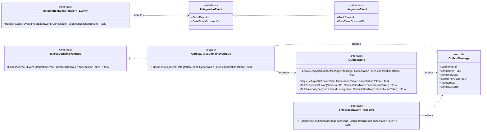
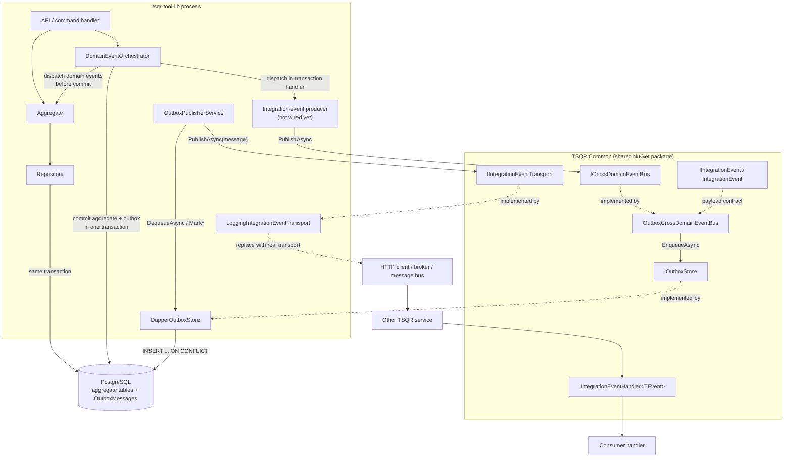
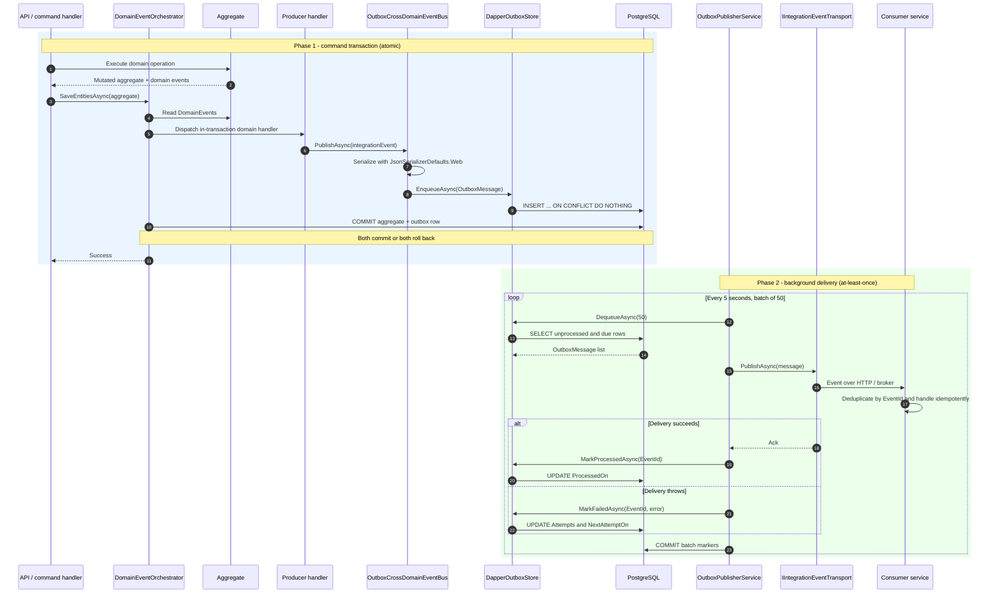

# TSQR.Common/Messaging

Date: 2026-11-02

Status: contracts and outbox pipeline implemented in `TSQR.Common` and
`tsqr-tool-lib`; the real cross-service transport and consumer-side inbox are
not implemented yet.

## 1. What this package is

`TSQR.Common/Messaging` is a small set of **ports** for integration events plus
one concrete implementation of the publish side: an outbox-backed event bus.

It deliberately does not know about HTTP, RabbitMQ, Kafka, or a specific
database. Those concerns belong to the service that hosts the outbox:

- the **store** is implemented by `DapperOutboxStore` in `tsqr-tool-lib`
- the **background publisher** is `OutboxPublisherService` in `tsqr-tool-lib`
- the **transport** is currently `LoggingIntegrationEventTransport`, a
  placeholder that only writes to the application log

This separation is the point: the shared package defines the contract, and each
service chooses how to persist and deliver events.

## 2. Class map

| Type | Kind | Responsibility |
|---|---|---|
| `IIntegrationEvent` | interface | Marker for an event that crosses a service/bounded-context boundary. Carries `EventId` and `OccurredOn`. |
| `IntegrationEvent` | abstract record | Convenience base class. Generates `EventId` and `OccurredOn` once at construction. |
| `ICrossDomainEventBus` | interface | Publishes an integration event. The caller does not know whether the event goes to an outbox, broker, or HTTP endpoint. |
| `IIntegrationEventHandler<TEvent>` | interface | Consumer-side contract for handling a received integration event. |
| `OutboxMessage` | record | Persisted envelope: event id, CLR event type name, JSON payload, occurrence time, attempts, last error. |
| `IOutboxStore` | interface | Durable store for outbox messages: enqueue, dequeue a batch, mark processed, mark failed. |
| `OutboxCrossDomainEventBus` | sealed class | `ICrossDomainEventBus` implementation. Serializes the event to JSON and writes an `OutboxMessage`; it does **not** deliver it. |
| `IIntegrationEventTransport` | interface | Adapter used by the background publisher to actually send an `OutboxMessage` over HTTP, a broker, or another transport. |

The concrete runtime classes live outside the shared package:

| Type | Location | Responsibility |
|---|---|---|
| `DapperOutboxStore` | `tsqr-tool-lib/Infrastructure` | PostgreSQL implementation of `IOutboxStore`, using the command's `ISqlUnitOfWork` and `OutboxMessages` table. |
| `OutboxPublisherService` | `tsqr-tool-lib/WebApi` | Background `IHostedService`; polls the outbox every 5 seconds, publishes a batch, and marks rows processed or failed. |
| `LoggingIntegrationEventTransport` | `tsqr-tool-lib/WebApi` | Placeholder `IIntegrationEventTransport`; logs the event instead of sending it. |

## 3. Class diagram

## 4. Architectural view

The important detail is that two different event systems exist side by side:

1. **Domain events** (`TSQR.Common.Events`) are in-process. They are dispatched
   by `DomainEventOrchestrator` before the database transaction commits, so an
   in-transaction handler can participate in the same transaction.
2. **Integration events** (`TSQR.Common.Messaging`) are cross-service. They are
   written to the outbox in the command transaction and delivered later by a
   background publisher.

### Why the producer is marked "not wired yet"

The runtime infrastructure is registered in `tsqr-tool-lib`, but no production
code currently calls `ICrossDomainEventBus.PublishAsync` and no concrete
`IIntegrationEvent` record exists outside the unit test. The outbox table is
therefore present and the publisher is healthy, but it has nothing to deliver.
The diagram shows the intended producer seam; adding a domain-event handler that
publishes an integration event is the remaining wiring step.

## 5. Sequence diagram

The producer and consumer legs show the intended end-to-end path. The only
transport in the tree today is the logging placeholder, so no external service
actually receives the event yet.

### Step-by-step

1. A command handler mutates an aggregate and calls
   `DomainEventOrchestrator.SaveEntitiesAsync`.
2. The orchestrator dispatches the aggregate's in-transaction domain events.
3. An in-transaction handler (the producer) calls
   `ICrossDomainEventBus.PublishAsync`.
4. `OutboxCrossDomainEventBus` serializes the event with
   `JsonSerializerDefaults.Web` and creates an `OutboxMessage`. `EventType` is
   the event's CLR full name; `Payload` is JSON.
5. `DapperOutboxStore.EnqueueAsync` inserts the row through the same
   `ISqlUnitOfWork`/transaction as the aggregate writes. The insert uses
   `ON CONFLICT (EventId) DO NOTHING`, so re-enqueuing the same event is safe.
6. The orchestrator commits. The aggregate change and the outbox row are now
   durable together; if the command rolls back, neither exists.
7. `OutboxPublisherService` wakes up every 5 seconds, takes up to 50 rows whose
   `ProcessedOn` is null and whose `NextAttemptOn` is due, and publishes them
   sequentially.
8. On success, `MarkProcessedAsync` sets `ProcessedOn`. On failure,
   `MarkFailedAsync` increments `Attempts`, records `LastError`, and schedules
   the next attempt with `LEAST(Attempts + 1, 10) * 30 seconds` (30 seconds up
   to 5 minutes).
9. The transport delivers the event to another TSQR service. That consumer is
   expected to deduplicate by `EventId` and handle the event idempotently.

Delivery is **at-least-once**, not exactly-once. A duplicate can occur if the
transport succeeds but the `ProcessedOn` update or its commit fails afterward.
That is why `EventId` is part of the contract.

## 6. Problems these classes solve in TSQR

TSQR is split across separate services (`tsqr-autheo`, `tsqr-identity`,
`tsqr-communities`, `tsqr-support`, `tsqr-soup-kitchen`, `tsqr-tool-lib`,
`tsqr-gateway`, and the UIs). A tool-library operation often has consequences
outside the tool-library database: a loan becomes overdue, a reservation
becomes available, a member is verified, a tool is registered. Calling another
service directly from a command handler creates the classic dual-write problem.

| Problem | How the messaging classes address it | Why it matters for TSQR |
|---|---|---|
| **Dual write / lost events** | Aggregate write and `OutboxMessages` insert share one local transaction. The publisher runs later. | The loan/return/reservation state and the notification event cannot diverge because one side committed. |
| **Ghost events** | The outbox row is rolled back with the command if the aggregate write fails. | A failed loan cannot still produce a "loan created" notification. |
| **Temporary transport failure** | `MarkFailedAsync` records the error and schedules a retry; the event stays durable. | A notification service or broker being down does not lose the business event. |
| **Service coupling** | Producers depend on `ICrossDomainEventBus`; consumers depend on `IIntegrationEventHandler<T>`. Neither side knows the other's URL or implementation. | Tool-lib can publish without taking a runtime dependency on support/identity/communities. |
| **Transport changes** | `IIntegrationEventTransport` isolates the actual delivery mechanism. | Start with logging, later replace it with HTTP or a broker without changing command handlers. |
| **Duplicate delivery** | `EventId` is stable; the producer insert is idempotent; consumers are expected to deduplicate. | Retries after a timeout or crash are safe once the consumer-side inbox is added. |
| **Auditability / replay** | The full JSON payload, type, occurrence time, attempts, and last error are persisted. | An operator can inspect what was produced and why delivery failed; a replay tool can be added later. |
| **Testability** | `IOutboxStore` and `IIntegrationEventTransport` are small interfaces. | The outbox bus can be unit-tested without a database or broker (there is already such a test). |

### When to use which event type

| Need | Use |
|---|---|
| Same service, same transaction, must roll back together | `IDomainEventHandler<TEvent>` and `DomainEventOrchestrator` |
| Slow side effect after commit, best effort, no rollback | `IPostCommitDomainEventHandler<TEvent>` |
| Cross-service durable handoff, eventual consistency | `IIntegrationEvent` through the outbox |

The outbox is for side effects and cross-service workflows, not for decisions
that need an immediate, strongly consistent answer. A command that must know
"is this item available right now?" should keep that check local or use a
synchronous query; it should not wait for an integration event round trip.

**Usage rule:** for the outbox guarantee, call
`ICrossDomainEventBus.PublishAsync` while the command's unit-of-work transaction
is still open — normally from an in-transaction domain-event handler. A
post-commit handler runs after the commit; enqueueing there is not atomic with
the aggregate write and should only be used for best-effort work.

## 7. Current state in the TSQR stack

- `tsqr-tool-lib` is the only service currently wired to the messaging
  contracts.
- `Program.cs` registers:
  - `IOutboxStore` → `DapperOutboxStore`
  - `ICrossDomainEventBus` → `OutboxCrossDomainEventBus`
  - `IIntegrationEventTransport` → `LoggingIntegrationEventTransport`
  - `OutboxPublisherService` as a hosted service
- The `OutboxMessages` table and its pending index exist in
  `tsqr-deploy/infra/02-tool-library.sql` and the tool-lib Docker init script.
- The publisher is running and the table currently has no pending rows.
- There are no concrete production integration events, no producer call site,
  and no consumer `IIntegrationEventHandler<T>` implementation yet.
- The domain-event pipeline is active and separate; it handles in-process
  aggregate side effects such as inventory reservations and queue promotion.

This means the outbox is currently a **ready seam**, not a working
cross-service message flow. The unit test
`OutboxCrossDomainEventBusTests` verifies serialization and enqueueing, but no
integration test exercises a real transport and consumer.

## 8. Design notes and current limitations

- **At-least-once, not exactly-once.** Consumers must deduplicate by `EventId`.
- **No strict ordering.** Messages are selected by `OccurredOn`, but a retry
  delays one message while later messages can proceed. Do not rely on global or
  per-aggregate ordering.
- **No dead-letter queue.** After `Attempts` reaches 10, the retry interval
  stays at 5 minutes and the message is retried indefinitely. A poison message
  needs operational handling.
- **No inbox/deduplication table.** `EventId` is available, but each consumer
  must implement its own idempotency store.
- **Publisher holds a transaction open during transport.** The current
  `OutboxPublisherService` reads a batch, calls the transport, then commits the
  processed/failed markers in one unit of work. That is fine for the logging
  placeholder, but a slow HTTP/broker call would hold a database transaction
  open. For production, consider a claim/lease column or separate read/update
  transactions.
- **No cleanup of processed rows.** `OutboxMessages` grows until a retention
  job is added.
- **`EventType` is a CLR full name.** Renaming or moving an event class is a
  breaking wire change. There is no schema-version field, so payload changes
  must be backward compatible.
- **No correlation/causation/tenant fields in the envelope.** A community id or
  correlation id currently has to live in the event payload.
- **No shared concrete-event contract project yet.** `TSQR.Common` contains the
  base contract, but concrete integration events still need a shared assembly
  that both producer and consumer can reference without depending on each
  other's service project.
- **Transport is a placeholder.** `LoggingIntegrationEventTransport` only logs;
  no other service receives events today.

## 9. Adding a real integration event

1. Define a record that inherits `IntegrationEvent` with a stable name.
2. Publish it from an in-transaction domain-event handler through
   `ICrossDomainEventBus`.
3. Implement `IIntegrationEventTransport` for the chosen HTTP/broker mechanism
   and replace the logging registration.
4. On the consumer side, deserialize by `EventType`, resolve
   `IIntegrationEventHandler<TEvent>`, and deduplicate by `EventId`.
5. Add an inbox/processed-events table so a redelivery cannot apply the same
   side effect twice.
6. Add a failure/dead-letter policy and an outbox retention job.

## 10. File reference

| Path | Role |
|---|---|
| `tsqr-common/src/TSQR.Common/Messaging/IIntegrationEvent.cs` | Event contract and `IntegrationEvent` base record. |
| `tsqr-common/src/TSQR.Common/Messaging/ICrossDomainEventBus.cs` | Publisher and consumer handler contracts. |
| `tsqr-common/src/TSQR.Common/Messaging/OutboxMessage.cs` | Persisted event envelope. |
| `tsqr-common/src/TSQR.Common/Messaging/IOutboxStore.cs` | Durable outbox store contract. |
| `tsqr-common/src/TSQR.Common/Messaging/OutboxCrossDomainEventBus.cs` | Serializes events and enqueues them. |
| `tsqr-common/src/TSQR.Common/Messaging/IIntegrationEventTransport.cs` | Transport adapter contract. |
| `tsqr-tool-lib/src/TSQR.ToolLibrary.Infrastructure/Persistence/Relational/Dapper/Outbox/DapperOutboxStore.cs` | PostgreSQL outbox store. |
| `tsqr-tool-lib/src/TSQR.ToolLibrary.WebApi/Messaging/OutboxPublisherService.cs` | Background publisher loop. |
| `tsqr-tool-lib/src/TSQR.ToolLibrary.WebApi/Messaging/LoggingIntegrationEventTransport.cs` | Current placeholder transport. |
| `tsqr-tool-lib/src/TSQR.ToolLibrary.WebApi/Program.cs` | DI registration. |
| `tsqr-deploy/infra/02-tool-library.sql` | `OutboxMessages` schema and pending index. |
| `tsqr-tool-lib/tests/unit-tests/TSQR.ToolLibrary.Domain.UnitTests/OutboxCrossDomainEventBusTests.cs` | Serialization/enqueue test. |
| `tsqr-tool-lib/src/TSQR.ToolLibrary.Application/DomainEventOrchestrator.cs` | In-process domain-event dispatch and commit ordering. |
